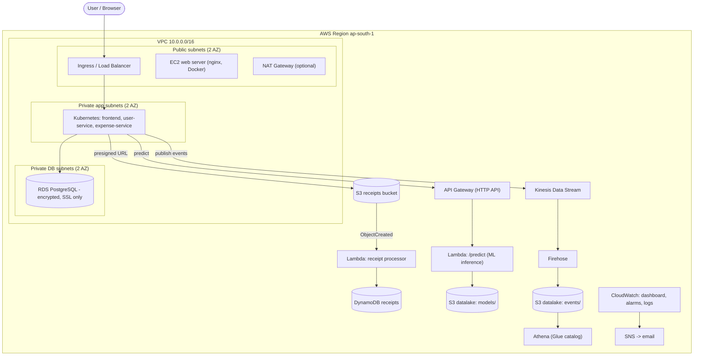
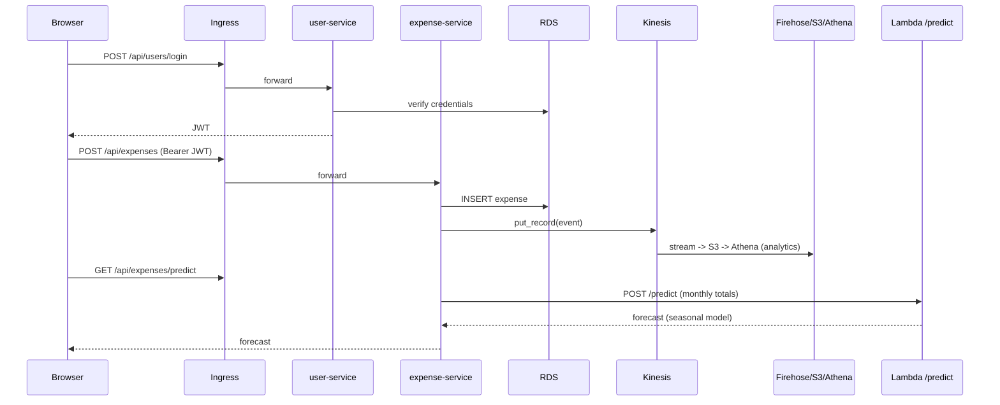

# Cloud Architecture Document: CloudOps Expense Platform

## 1. System design

Cloud: **AWS (ap-south-1, Mumbai)**. Provisioned entirely through Terraform.

## 2. VM setup (Module 1)
* **EC2 t3.micro**, Amazon Linux 2023 (latest AMI via SSM parameter), public subnet, encrypted gp3 root volume.
* nginx installed via user-data; Docker installed for the virtualization-vs-containers comparison.
* **No SSH port open**: administration through AWS Systems Manager Session Manager.
* IMDSv2 enforced; detailed monitoring enabled; CloudWatch agent policy attached.

### Virtualization vs containerization

| Aspect | Virtual Machine (EC2) | Container (Docker) |
|---|---|---|
| Isolation | Full guest OS on hypervisor | Process-level, shared host kernel |
| Start-up | Minutes | Seconds |
| Size | GBs | MBs |
| Density | Few per host | Many per host |
| Security boundary | Stronger | Weaker (kernel shared) |
| Use here | Public web server (IaaS demo) | Microservices on Kubernetes |

Demo for your report: `time` the boot of the EC2 instance vs `docker run nginx`, compare `docker images` size vs AMI/volume size.

## 3. VPC layout (Module 2)

| Tier | CIDR | Routing |
|---|---|---|
| Public AZ-a / AZ-b | 10.0.0.0/24, 10.0.1.0/24 | 0.0.0.0/0 -> Internet Gateway |
| Private app AZ-a / AZ-b | 10.0.10.0/24, 10.0.11.0/24 | 0.0.0.0/0 -> NAT (if enabled); S3 via gateway endpoint |
| Private DB AZ-a / AZ-b | 10.0.20.0/24, 10.0.21.0/24 | No internet route |

Security groups: **web-sg** (80/443 from internet), **db-sg** (5432 only from web-sg and private app subnets).
VPC Flow Logs go to CloudWatch Logs.

## 4. Microservices architecture (Module 3)

| Service | Port | Responsibility | Data |
|---|---|---|---|
| `frontend` | 8080 | Static UI + reverse proxy | none |
| `user-service` | 5001 | Register, login, JWT issue | PostgreSQL `users` |
| `expense-service` | 5002 | Expense CRUD, summaries, forecast, presigned receipt URL, Kinesis events | PostgreSQL `expenses` |
| Lambda `api` | n/a | `/predict` ML inference | S3 `models/model.json` |
| Lambda `receipt-processor` | n/a | S3 upload trigger | DynamoDB |

Kubernetes: 2 replicas each, rolling updates, readiness/liveness probes, resource limits, HPA (70% CPU, max 6),
non-root containers, dropped capabilities, default-deny NetworkPolicy, Ingress path routing
(`/api/users`, `/api/expenses`, `/`).

## 5. Data flow

**Receipt flow:** browser asks `expense-service` for a presigned URL -> uploads directly to S3 -> S3 event triggers Lambda -> metadata saved in DynamoDB.

## 6. Security model (Module 4)

| Control | Implementation |
|---|---|
| Least privilege | Separate IAM role per Lambda with only the actions/resources needed; EKS node role scoped to one stream + one S3 prefix |
| Permission boundary | `*-permission-boundary` policy attached to the developer role; denies IAM/billing changes |
| MFA | Developer and auditor roles can only be assumed with `aws:MultiFactorAuthPresent = true`; enable MFA on root + every IAM user |
| Role-based access | `developer` (PowerUser ∩ boundary), `auditor` (ReadOnly), CI role (ECR push + deploy only) |
| No long-lived CI keys | GitHub Actions uses OIDC to assume `*-github-ci` |
| Encryption at rest | S3 SSE-S3, RDS `storage_encrypted`, DynamoDB SSE, EBS encrypted, Kinesis KMS, SNS KMS, Secrets Manager |
| Encryption in transit | S3 bucket policy denies non-TLS; RDS `rds.force_ssl=1`; API Gateway HTTPS; add ACM cert + HTTPS on Ingress for production |
| Network isolation | DB in private subnets with no public IP; SG-to-SG rules; Kubernetes NetworkPolicy |
| Secrets | DB password generated by Terraform, stored in Secrets Manager; JWT secret in Kubernetes Secret |
| Image security | ECR scan-on-push, non-root containers, Trivy in CI |
| Audit | VPC Flow Logs, EKS audit logs, CloudWatch Logs; enable CloudTrail account-wide |

## 7. Monitoring and alerting
* **CloudWatch dashboard** `*-overview`: EC2 CPU, RDS CPU/connections, Lambda invocations/errors, API Gateway requests/4xx/5xx, Kinesis records, live log query.
* **Alarms -> SNS -> email:** EC2 CPU, EC2 status check (uptime), RDS CPU, Lambda errors, API 5xx.
* **Billing alert:** AWS Budget (80% actual, 100% forecast) on `monthly_budget_usd`.

## 8. Big Data + ML pipeline (summary for Deliverable 7)
1. `expense-service` publishes each transaction to **Kinesis Data Streams** (real-time ingestion).
2. **Firehose** batches events to the S3 data lake (`events/`), lifecycle-archived to Glacier after 60 days.
3. **Glue Data Catalog + Athena** act as the serverless data warehouse (SQL in `streaming/athena_queries.sql`).
4. `ml/train.py` learns monthly **seasonal indices** from history and writes `model.json` to S3.
5. **Lambda + API Gateway** serve inference: linear trend of the user's spend x seasonal index of the next month.
6. Inference is automated: every dashboard load calls `/api/expenses/predict`.

*Scaling up (optional for the report):* replace Athena with Redshift/BigQuery, the Lambda model with SageMaker/Vertex AI endpoints, and add EMR/Dataproc Spark jobs for heavy batch processing. The architecture stays the same.
